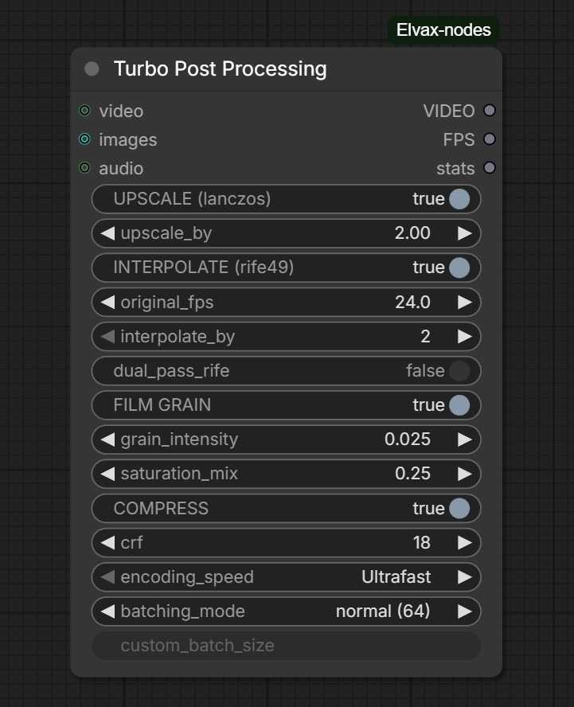
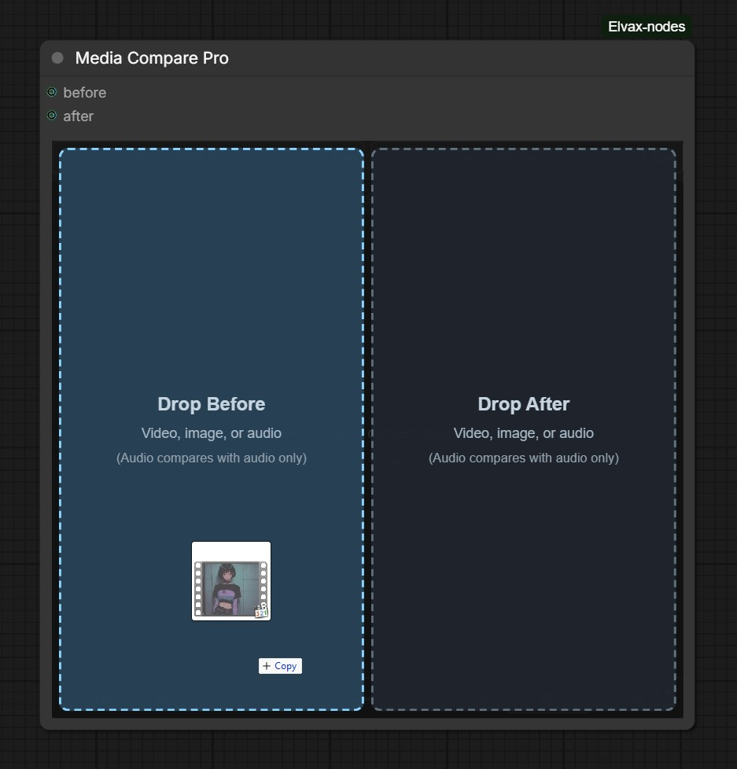
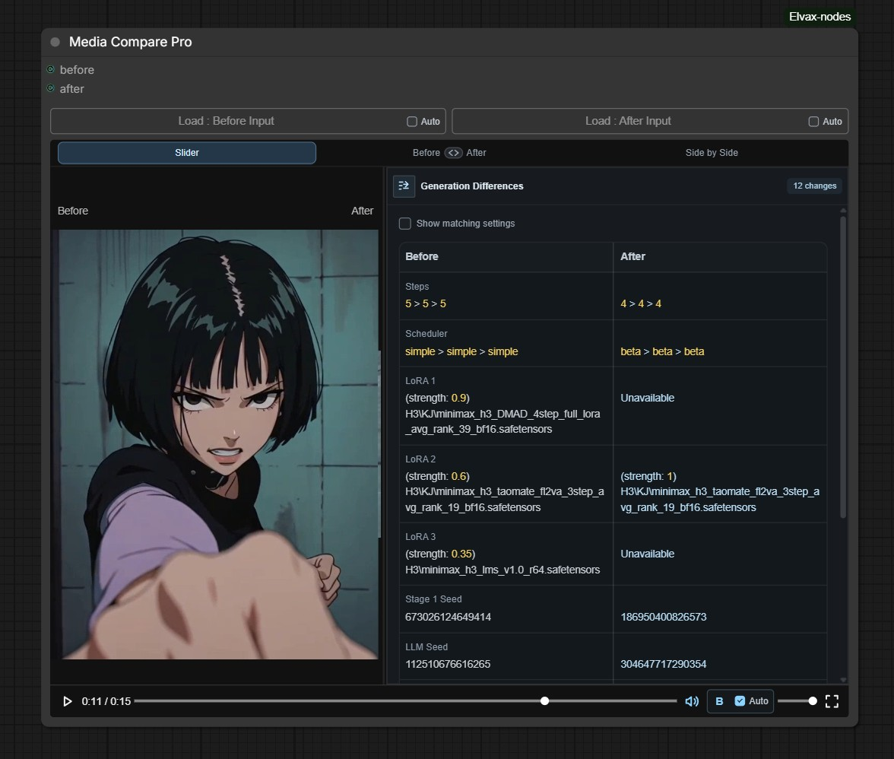
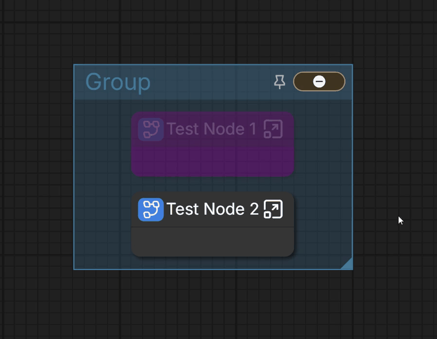
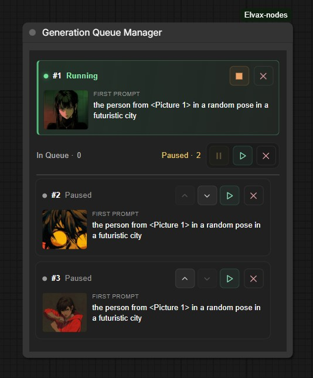
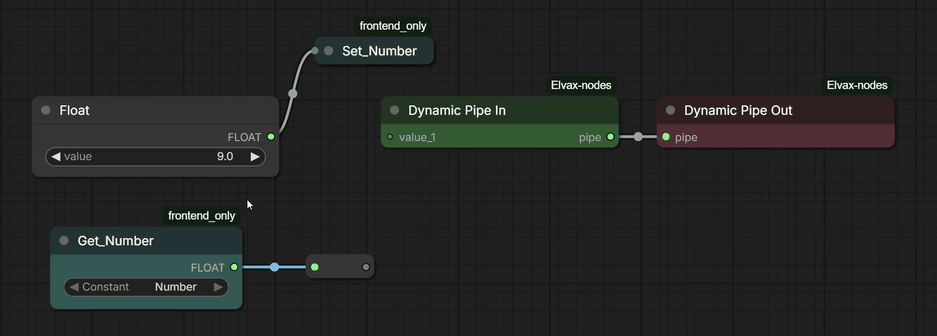
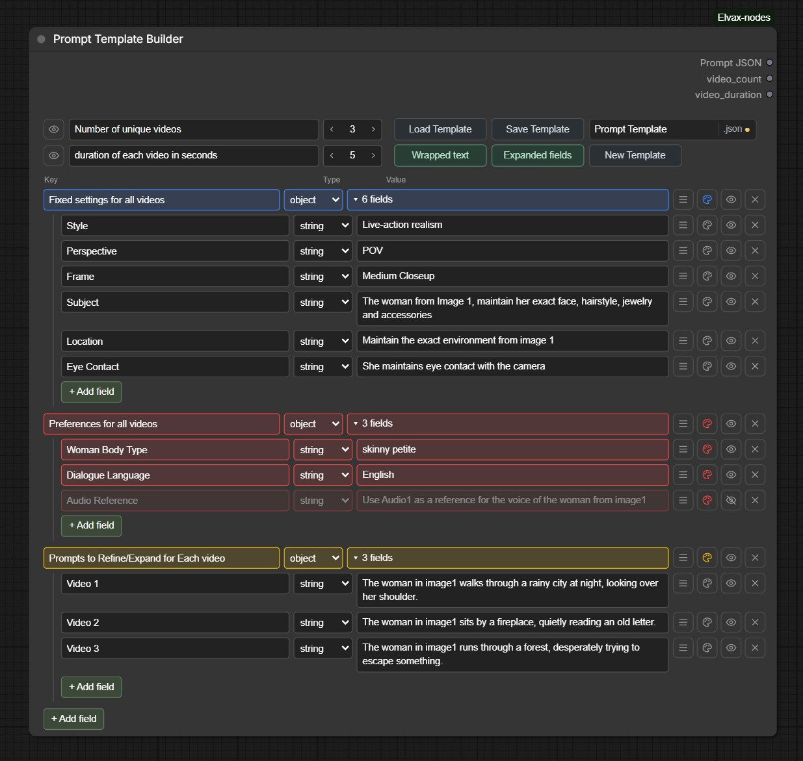
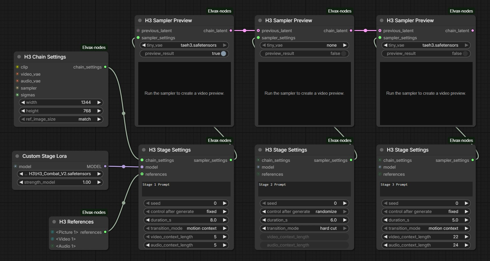
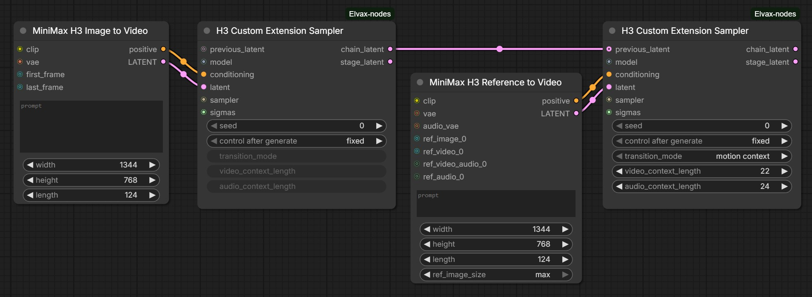
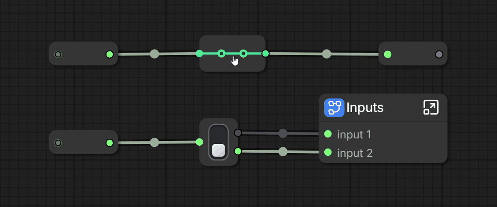

# Elvax Nodes

Convenience nodes for ComfyUI!

- LLM TURBO: Run local LLMs faster, directly in ComfyUI
- Load and crop images faster in one node
- Upscale, interpolate, and add film grain in one node
- Tidy workflows with Dynamic Pipes, supporting Set/Get nodes and reroutes
- Extend Minimax H3 Videos

And more...

## LLM Turbo


Run local GGUF models directly inside ComfyUI at blazing speed through the 
llama.cpp backend, with no external LLM app, setup, or headache! 

Use dynamically growing image or audio inputs, including image batches, 
and use MTP (speculative decoding) where supported to speed things even more.

Track your generation speed through `stats`.

Put your GGUF models in `models/LLM` or `models/text_encoders`

Image and audio inputs require a compatible model and projector (`mmproj`).


## Load/Crop Image

Load and crop an image quickly in one node. Refine the crop interactively, send
the current image and its matching mask downstream, or restore the original.
Enable `scale_image` to resize the cropped result to the selected megapixels using
Lanczos. The resolution below the preview shows the output dimensions.


## Turbo Post Processing

Upscale with Lanczos to improve quality, interpolate with RIFE 4.9 to smooth motion,
and add film grain to reduce the digital AI look, all in one fast node,
with extra VRAM Optimizations to prevent OOM.



## Media Compare Pro

Compare videos, single images, or audio and inspect their generation differences. Drag and drop media or load connected inputs manually or automatically. Compare audio with audio only.

<table>
<tr>
<td align="center"></td>
<td align="center"></td>
</tr>
</table>

## Fast Group Toggles

Toggle groups ON/OFF to enable or bypass their nodes; click the pin to pin or unpin.

Right-click the switch to hide controls. To restore them, right-click the group’s upper-right corner and select **Show Elvax Group Controls**.



## Generation Queue Manager

Manage ComfyUI's generation queue. Reorder, pause, resume, or cancel jobs. Stop a running job and keep it saved to run again. Paused jobs remain saved across restarts.



## Dynamic Pipe In / Dynamic Pipe Out

Tidy your complex workflows with Dynamic Pipes : 
Dynamic Pipe In grows as you connect values; Dynamic Pipe Out unpacks them into
separate outputs in their original order, Supports Set/Get nodes and Reroutes!



## Prompt Edit / Preview

**Preview** and **edit** text in one node. Edit the preview text with one click,
Supports the browser’s built-in spell checker
to detect and correct spelling and grammar errors.


## Prompt Template Builder / JSON Prompt Splitter

Build a structured JSON prompt that you can feed to your favourite LLM
with editable/nested fields, customizable field colours.
Save/load preserves everything in the JSON including hidden fields and colours.

JSON Prompt Splitter splits a JSON prompt into the selected number of videos, as specified in Prompt Template Builder. It bypasses unused stages in groups named **Group 1**, **Group 2**, and so on.



## H3 Staged Samplers

Build a MiniMax H3 generation as a configurable stage-by-stage chain. Set shared
generation parameters once in `H3 Chain Settings`, then tailor each stage with
`H3 Stage Settings`. Use `H3 Sampler Preview` to sample the stage, optionally
show a live tiny-VAE preview or decode the full video, and pass the accumulated
latent into the next stage. Motion Context continues from prior latent context;
Hard Cut starts a fresh joined segment.

`H3 Chain Settings`: Configure the shared settings for a MiniMax H3 extension
chain.

`H3 Stage Settings`: Configure each stage of a MiniMax H3 extension chain
independently (supports custom Loras for each stage)

`H3 Sampler Preview`: Sample a stage, optionally show a live tiny-VAE preview
during sampling or decode a full video preview, and pass the accumulated latent
to the next stage. The `preview_result` toggle controls full video decoding;
live previews are available when a tiny VAE is selected.
With `preview_result` enabled, select this node as an output in App Builder to
play its finished video in App Mode. Live tiny-VAE previews use the graph player.

`H3 References`: Bundle picture, video, and audio references with MiniMax H3
token labels for use in H3 Stage Settings. Audio slots 1–3 pair with their
matching connected video slots; remaining audio slots are standalone.



## H3 Custom Extension Sampler

Seamlessly extend a MiniMax H3 generation from one sampler stage to the next,
with controls to customize exactly how you want it built. Sampling stays
lightweight: the node returns the accumulated `chain_latent` and this stage's
`stage_latent` without decoding, so you can connect your preferred preview or
decode workflow.



## Reroute Switch / Circuit Switch

Connect any value and use the A/B toggle to choose which output receives it.
The inactive output blocks its branch; its links stay connected and appear gray.
An inactive route into an optional socket is treated as disconnected during execution.
Media Compare Pro can load through the active route while keeping both captured inputs.
The selected output is saved with the workflow.

Connect a value through the switch and click the circuit contact to open or close it.
Closed passes the value by default; open blocks execution while keeping the wire connected.



# Installation

### ComfyUI Manager

Open **Manager → Custom Nodes Manager**, search for **Elvax Nodes**, and select
**Install**. Restart ComfyUI.

### Manual installation

Clone this repository into `ComfyUI/custom_nodes`:

```bash
git clone https://github.com/younestft/Elvax-nodes.git
```

Install the Python dependency with the Python environment used by ComfyUI:

```bash
python -m pip install -r ComfyUI/custom_nodes/Elvax-nodes/requirements.txt
```

Restart ComfyUI. The nodes appear under the `Elvax` category.


# License and credits

This repository is licensed under GNU GPL v3 or later; see [LICENSE](LICENSE).

Many nodes in this pack are based on or inspired by ComfyUI's native nodes.
Credit to the Comfy Org team for ComfyUI and its native node implementations.
The H3 tiny-VAE preview is credited to Kijai and [KJNodes](https://github.com/kijai/ComfyUI-KJNodes).

LLM Turbo is adapted from the GPL-3.0-licensed
[ComfyUI-LLM-text-processor](https://github.com/KingManiya/ComfyUI-LLM-text-processor)
by KingManiya. with added Audio and MTP support + further UI and quality of life improvements.

The H3 Extension Sampler is a modified derivative of
[ComfyUI-H3-Motion-Context](https://github.com/NikoDemon80/ComfyUI-H3-Motion-Context)
by NikoDemon80.

The bundled H3 References node is adapted from the GPL-3.0-licensed
[ComfyUI-H3-Prompt-IDE](https://github.com/ethanfel/ComfyUI-H3-Prompt-IDE) by
Ethan Fel.

Turbo Post Processing brings together ComfyUI's native Lanczos image scaling,
RIFE 4.9 interpolation from [Fill-Nodes](https://github.com/filliptm/ComfyUI_Fill-Nodes)
by filliptm, and Fast Film Grain from
[VRGameDevGirl's nodes](https://github.com/vrgamegirl19/comfyui-vrgamedevgirl) 
and adds further performance and VRAM optimizations.
